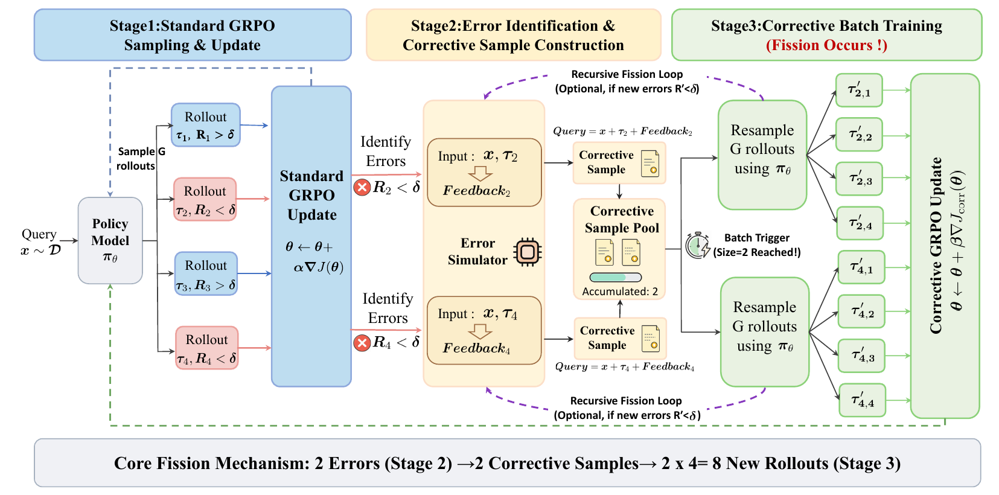
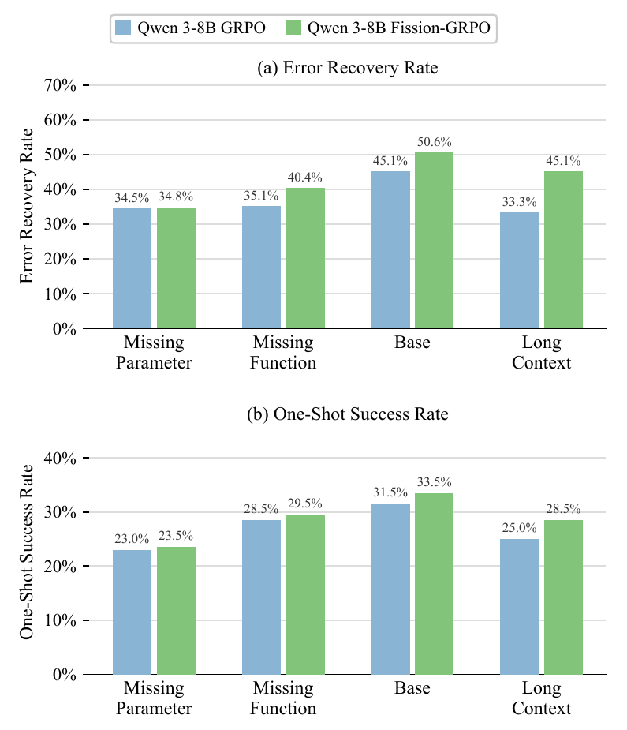

# Fission-GRPO: Learning to Recover from Execution Errors

<p align="center">
  <a href="https://arxiv.org/abs/2601.15625"></a>
  
</p>

Official code for **Robust Tool Use via Fission-GRPO: Learning to Recover from Execution Errors** (ACL 2026, Long Papers).

**Zhiwei Zhang, Fei Zhao, Rui Wang, Zezhong Wang, Bin Liang, Jiakang Wang, Yao Hu, Shaosheng Cao, and Kam-Fai Wong**

[Paper](https://arxiv.org/abs/2601.15625) · [PDF](https://arxiv.org/pdf/2601.15625) · [Training](#training) · [Results](#results) · [Citation](#citation)

## Why learn from execution errors?

Tool-using models can generate valid calls yet struggle to recover when a call fails. A model may repeatedly retry an invalid action or invent unsupported arguments instead of interpreting the error and correcting its behavior. Standard reinforcement learning supplies a negative reward, but little guidance on how to recover. Offline correction datasets also become less representative as the policy's failure modes evolve.

**Fission-GRPO turns the policy's own failures into new opportunities to learn recovery.** It constructs feedback-augmented contexts during training and samples fresh recovery attempts from the current policy, keeping corrective experience aligned with the errors the model actually makes.

## Method



*Figure 2 from the paper. A failed rollout becomes a corrective context from which multiple recovery rollouts are sampled.*

1. **Explore:** sample tool-use trajectories and update the policy with standard GRPO.
2. **Diagnose:** identify failed trajectories and append diagnostic feedback from an Error Simulator. The simulator is trained to describe the error without revealing the ground-truth answer.
3. **Recover:** collect corrective contexts into a batch, resample multiple recovery attempts on-policy, and perform a corrective GRPO update.

The implementation buffers and deduplicates corrective contexts and controls how often correction batches run. It supports both fixed error feedback and an OpenAI-compatible feedback model. The paper's full method uses a fine-tuned Error Simulator; a generic API model is an alternative backend, not an equivalent reproduction of that simulator.

## Results

Results below are from **Table 1 of the paper**, not measurements produced by this repository setup. BFCL v4 Multi-Turn reports accuracy (%); TAU-Bench and TAU2-Bench report pass@1 (%) with GLM-5 as the user simulator.

### BFCL v4 Multi-Turn

| Method | Qwen3-1.7B | Qwen3-4B | Qwen3-8B |
|---|---:|---:|---:|
| Base | 7.80 | 19.37 | 28.75 |
| GRPO | 17.12 | 36.38 | 42.75 |
| DAPO | 16.00 | 38.25 | 43.12 |
| Dr.GRPO | 16.12 | 34.75 | 44.88 |
| AWPO | — | 38.75 | 44.50 |
| **Fission-GRPO** | **20.38** | **40.87** | **46.75** |

On Qwen3-8B, Fission-GRPO improves overall accuracy by **4.00 percentage points** over GRPO (42.75 → 46.75). Average error recovery improves by approximately **5.7 points**, while one-shot success improves by **1.75 points** (Figure 3).

<p align="center">
  
</p>

*Figure 3 from the paper. Improvements are driven primarily by recovery after an execution error, while preserving one-shot performance.*

### Generalization to TAU benchmarks

| Qwen3-8B method | TAU Retail | TAU Airline | TAU2 Retail | TAU2 Airline | TAU2 Telecom |
|---|---:|---:|---:|---:|---:|
| GRPO | 39.1 | 36.0 | 28.1 | 26.0 | 52.5 |
| Fission-GRPO | **51.3** | **40.0** | **36.8** | **32.0** | **55.0** |

The table compares Fission-GRPO with GRPO; the full paper includes other baselines. At 4B, TAU Retail improves from 20.0 to 37.4 (+17.4 points). See the paper for all model scales, feedback ablations, and simulator analysis.

## Repository layout

```text
.
├── assets/                    # Figures from the paper
├── data/                      # Training Parquet files
├── verl_fission_exp/          # Modified verl training framework
│   ├── scripts/train.sh      # Reference training launcher
│   └── verl/trainer/ppo/     # GRPO and correction-stream implementation
├── bfcl_v4_benchmark/         # BFCL evaluation code
└── tau2-bench-main/           # TAU2 evaluation code
```

### Training data

| File | Samples | Purpose |
|---|---:|---|
| [`multi_turn_data_630_train.parquet`](data/multi_turn_data_630_train.parquet) | 630 | Training set used for the paper's main experiments |
| [`merged_output_single2000_multi_turn2000_4000samples_train.parquet`](data/merged_output_single2000_multi_turn2000_4000samples_train.parquet) | 4,000 | Additional mixed single-turn / multi-turn training data for experimentation |

Use the **630-sample dataset** when following the main experimental setting. The 4,000-sample file is an additional resource.

## Training

### Environment

The paper uses a single node with **8 × H800 80GB GPUs**. The reference launcher also defaults to eight GPUs and a vLLM rollout backend. Prepare a compatible CUDA, PyTorch, and vLLM environment following the bundled [verl installation guide](verl_fission_exp/README.md), then install the modified framework:

```bash
# Run from the repository root in your prepared training environment.
pip install -e ./verl_fission_exp
```

### Configure and launch

The entry point is [`verl_fission_exp/scripts/train.sh`](verl_fission_exp/scripts/train.sh). Replace the model and validation paths below before running:

```bash
export REPO_ROOT="$(pwd)"
export PROJECT_FOLDER="$REPO_ROOT/verl_fission_exp"
export ori_checkpoint_path=/path/to/Qwen3-8B
export TRAIN_FILES_JSON="[\"$REPO_ROOT/data/multi_turn_data_630_train.parquet\"]"
export VAL_FILES_JSON='["/path/to/held_out_validation.parquet"]'
export OUTPUT_DIR="$REPO_ROOT/outputs/fission-qwen3-8b"
export LOG_DIR="$REPO_ROOT/logs/fission-qwen3-8b"

# Select and verify the reward implementation for your data schema.
export CUSTOM_REWARD_FUNCTION_PATH="$PROJECT_FOLDER/verl/utils/reward_score/multi_turn_reward_v2_dynamic_v3.py"

# The launcher enables W&B. Use offline logging for an initial local run,
# or configure WANDB_API_KEY securely in the runtime environment.
export WANDB_MODE=offline

bash "$PROJECT_FOLDER/scripts/train.sh"
```

**This is a reference workflow, not a one-command reproduction of every paper result.** Check the following before starting an experiment:

- The launcher's default reward path refers to a file absent from this snapshot. The example explicitly selects an included reward implementation; verify its behavior against your experiment's reward definition.
- The launcher defaults to `corr_acc_threshold=0.6`, whereas the paper specifies a correctness threshold of 1. Align the reward scale and correction settings with the intended experiment.
- Learning rate, batch size, rollout count, and prompt/response limits are configured in the launcher. The paper uses a learning rate of `1e-6`, batch size 8, eight rollouts per query, and length limits of 12,800 / 4,096 tokens.
- Choose a new output directory for each run: the launcher exits if its output directory is already nonempty.

### Error feedback

Without a configured feedback model, the correction pipeline can use its fixed fallback message:

```text
error: you made a mistake. please try again.
```

For dynamic feedback, configure an OpenAI-compatible service through the existing environment variables:

| Variable | Purpose |
|---|---|
| `XHS_MAAS_BASE_URL` | OpenAI-compatible endpoint URL |
| `XHS_MAAS_API_KEY` | Runtime API credential |
| `BFCL_SIMULATOR_API_KEY` | Alternative credential variable |
| `XHS_MAAS_MODEL` | Feedback model identifier |

These are the variable names currently consumed by the code; they can point to your own compatible service. Supply credentials through your environment rather than committing them. **The launcher currently sets `XHS_MAAS_MODEL=gpt-4.1` directly**, so adjust that assignment when using another model, including a fine-tuned Error Simulator. Simulator weights are not included in this source release.

## Evaluation

The bundled evaluation packages provide their own setup and execution instructions:

- [BFCL v4](bfcl_v4_benchmark/README.md): multi-turn tool-use evaluation.
- [TAU2-Bench](tau2-bench-main/README.md): interactive evaluation with a simulated user.

Configure model endpoints and runtime credentials for your environment. The TAU-Bench results above are reported from the paper; this snapshot includes TAU2 code, not a separate TAU1 evaluation package.

## Acknowledgments

This implementation builds on [verl](https://github.com/volcengine/verl), with evaluation using BFCL and TAU benchmarks. Please retain the license and attribution files included with third-party components.

## Citation

If you find this work useful in your research, please cite our paper:

```bibtex
@inproceedings{zhang2026robust,
  title={Robust Tool Use via Fission-GRPO: Learning to Recover from Execution Errors},
  author={Zhang, Zhiwei and Zhao, Fei and Wang, Rui and Wang, Zezhong and Liang, Bin and Wang, Jiakang and Hu, Yao and Cao, Shaosheng and Wong, Kam-Fai},
  booktitle={Proceedings of the 64th Annual Meeting of the Association for Computational Linguistics (Volume 1: Long Papers)},
  pages={40477--40491},
  year={2026}
}
```
